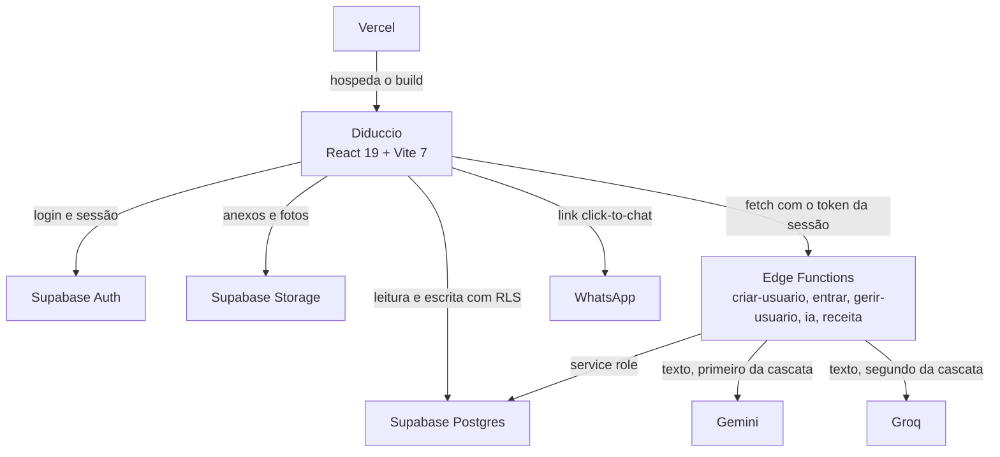

# FLUXOGRAMAS.md
<!-- gerado por /snapshot; não editar à mão -->

Fluxos do Diduccio no subset Mermaid que o dashboard desenha (flowchart TD, sequenceDiagram,
stateDiagram-v2). Renderiza nativo no GitHub.

## Contexto: quem fala com quem

**Quem é quem (para leigo):**
- **app** - o Diduccio no navegador: React servido pela Vercel, fala direto com o Supabase.
- **vercel** - hospeda o build estático e reescreve toda URL para `index.html`.
- **auth** - Supabase Auth guarda as contas; o login entra pela função `entrar`, que converte CPF em e-mail.
- **db** - Postgres do Supabase; o RLS decide o que cada cargo lê e escreve.
- **storage** - bucket do Supabase com fotos, atestados, notas e assinaturas.
- **edge** - funções Deno no Supabase para o que não pode rodar no navegador: criar e gerir usuário, login, IA e receita.
- **gemini** - modelos de texto do Google, primeiro provedor da função `ia`.
- **groq** - segundo provedor da função `ia`, usado quando o Gemini falha.
- **whatsapp** - link pronto que abre a conversa com o morador; o app não manda mensagem sozinho.
