# SCHEMA.md
<!-- gerado por /snapshot; não editar à mão -->

Diagrama relacional do Diduccio. Renderiza nativo no GitHub.

## Diagrama ER (Mermaid)

```mermaid
erDiagram
    entregas ||--o{ retirada_itens : "id_entrega"
    entregas_nf ||--o{ entregas_foto : "id_nota"
    entregas_nf ||--o{ retirada_itens : "id_nota"
    notificacoes ||--o{ notificacoes_anexos : "id_notificacao"
    retiradas ||--o{ entregas : "id_retirada"
    retiradas ||--o{ retirada_itens : "id_retirada"
    unidades ||--o{ churrasqueira : "unidade_id"
    unidades ||--o{ confirmacao : "id_unidade"
    unidades ||--o{ festas : "unidade_id"
    unidades ||--o{ moradores : "id_unidade"
    unidades ||--o{ mudancas : "id_unidade"
    unidades ||--o{ piscina : "id_unidade"
    unidades ||--o{ tarefas : "id_unidade"
    unidades ||--o{ vagas : "id_unidade"

    unidades {
        bigint id PK
        numeric bloco
        numeric unidade
        text ocupado
        text status
        numeric valor
        timestamptz created_at
        timestamptz updated_at
    }
    entregadores {
        bigint id PK
        text cpf
        text nome
        timestamptz created_at
        text created_by
        timestamptz updated_at
        text veiculo
        text placa
        _ mais_colunas "+3"
    }
    entregadores_chegadas {
        bigint id PK
        text cpf
        text nome
        text veiculo
        text placa
        text bloco
        text apartamento
        text liberado_por
        _ mais_colunas "+11"
    }
    assembleias {
        text id PK
        text titulo
        date data_assembleia
        text resumo_geral
        text decisoes
        text assinantes
        text pdf_url
        text pdf_id
        _ mais_colunas "+4"
    }
    confirmacao {
        bigint id PK
        numeric id_morador
        bigint id_unidade FK
        text nome
        text telefone
        text status
        text numero_solicitado
        timestamptz data_envio
        _ mais_colunas "+3"
    }
    log {
        bigint id PK
        text id_ref
        text usuario
        text acao
        text modulo
        text descricao
        timestamptz created_at
        timestamptz updated_at
    }
    churrasqueira {
        bigint id PK
        date data_reserva
        bigint unidade_id FK
        text morador
        text status
        text cpf
        numeric convidados
        numeric valor_taxa
        _ mais_colunas "+8"
    }
    uploads_churrasqueira {
        bigint id PK
        text id_festa
        text nome_arquivo
        text url_drive
        text file_id
        timestamptz created_at
        timestamptz updated_at
    }
    uploads_compras {
        text id PK
        text id_compras
        text nome_arquivo
        text url_drive
        text file_id
        timestamptz created_at
        timestamptz updated_at
    }
    moradores {
        bigint id PK
        bigint id_unidade FK
        text nome
        text cpf
        text tipo_vinculo
        text telefone
        text email
        date data_entrada
        _ mais_colunas "+7"
    }
    mudancas {
        bigint id PK
        bigint id_unidade FK
        text id_morador
        text morador
        text cpf
        text rg
        text contato
        text periodo
        _ mais_colunas "+8"
    }
    vagas {
        bigint id PK
        bigint id_unidade FK
        text possui_carro
        text vaga_carro
        text placa_carro
        text modelo_carro
        text status_carro
        text possui_moto
        _ mais_colunas "+10"
    }
    entregas {
        bigint id PK
        bigint id_unidade
        text id_morador
        text nome
        text telefone
        text quantidade_encomenda
        text numero_encomenda
        timestamptz data_entrada
        _ mais_colunas "+18"
    }
    entregas_foto {
        bigint id PK
        text id_entrega
        text nome_arquivo
        text url_drive
        text file_id
        timestamptz created_at
        text created_by
        timestamptz updated_at
        _ mais_colunas "+1"
    }
    entregas_nf {
        bigint id PK
        text id_encomenda
        text numero_fiscal
        text transportadora
        text created_by
        timestamptz created_at
        timestamptz updated_at
    }
    agendamentos {
        bigint id PK
        text tipo
        bigint id_unidade
        text nome
        text telefone
        date data
        time hora_inicio
        text duracao
        _ mais_colunas "+6"
    }
    piscina {
        bigint id PK
        bigint id_unidade FK
        text id_morador
        text nome
        date nascimento
        text telefone
        date validade_atestado
        text url_foto
        _ mais_colunas "+11"
    }
    compras {
        text id PK
        text solicitacao
        text produto
        text categoria
        text solicitado_por
        timestamptz solicitado_data
        text status
        text created_by
        _ mais_colunas "+12"
    }
    compras_produtos {
        text id PK
        text id_compra
        text produto
        numeric quantidade
        numeric valor
        timestamptz created_at
        timestamptz updated_at
    }
    auditoria {
        bigint id PK
        text tabela
        text acao
        text old_status
        text new_status
        timestamptz created_at
        text usuario
        timestamptz updated_at
    }
    notas {
        bigint id PK
        text id_compra
        text solicitacao
        text categoria
        text produto
        timestamptz comprado_em
        timestamptz solicitado_em
        text status
        _ mais_colunas "+10"
    }
    assinatura {
        bigint id PK
        text id_compra
        timestamptz data_solicitacao
        text descricao
        text valor
        text status
        text assinatura_base64
        text dispositivo
        _ mais_colunas "+2"
    }
    tags {
        bigint id PK
        numeric id_vagas
        bigint id_unidade
        text veiculo
        text status
        timestamptz created_at
        timestamptz updated_at
        text nome_solicitante
        _ mais_colunas "+4"
    }
    festas {
        bigint id PK
        date data_reserva
        bigint unidade_id FK
        text morador
        text status
        text cpf
        numeric convidados
        numeric valor_taxa
        _ mais_colunas "+7"
    }
    uploads_festas {
        text id PK
        numeric id_festa
        text nome_arquivo
        text url_drive
        text file_id
        timestamptz created_at
        timestamptz updated_at
    }
    multas {
        bigint id PK
        bigint id_unidade
        text descricao
        text valor
        date data
        text status
        timestamptz created_at
        timestamptz updated_at
    }
    uploads_piscina {
        bigint id PK
        text id_piscina
        text nome_arquivo
        text url_drive
        text file_id
        timestamptz created_at
        timestamptz updated_at
    }
    tentativas_login {
        text chave PK
        int tentativas
        timestamptz ate
    }
    retiradas {
        bigint id PK
        bigint id_unidade
        text retirado_por_nome
        text retirado_por_cpf
        bigint id_morador
        text via
        text assinatura_caminho
        text observacao
        _ mais_colunas "+3"
    }
    retirada_itens {
        bigint id PK
        bigint id_retirada FK
        bigint id_entrega FK
        int volumes
        timestamptz created_at
        bigint id_nota FK
    }
    notificacoes {
        bigint id PK
        text tipo
        bigint id_unidade
        bigint id_morador
        text destinatario
        text assunto
        text descricao
        date ocorrido_em
        _ mais_colunas "+5"
    }
    notificacoes_anexos {
        bigint id PK
        bigint id_notificacao FK
        text nome_arquivo
        text caminho_storage
        timestamptz created_at
        text created_by
        timestamptz updated_at
    }
    tarefas {
        bigint id PK
        text titulo
        text descricao
        text situacao
        bigint responsavel_id FK
        date prazo
        bigint id_unidade FK
        timestamptz concluida_em
        _ mais_colunas "+5"
    }
    notas_tarefas {
        bigint usuario_id PK
        text texto
        timestamptz updated_at
    }
```

## Indexes principais

| Tabela | Index | Colunas | Origem |
|--------|-------|---------|--------|
| `unidades` | `idx_unidades_status` | `status` | `0001_schema.sql` |
| `unidades` | `idx_unidades_created_at` | `created_at` | `0001_schema.sql` |
| `unidades` | `idx_unidades_updated_at` | `updated_at` | `0001_schema.sql` |
| `entregadores` | `idx_entregadores_created_at` | `created_at` | `0001_schema.sql` |
| `entregadores` | `idx_entregadores_updated_at` | `updated_at` | `0001_schema.sql` |
| `entregadores` | `uniq_entregadores_cpf` | `cpf` | `0034_portaria_recebe_visitantes.sql` |
| `entregadores_chegadas` | `idx_entregadores_chegadas_horario_entrada` | `horario_entrada` | `0001_schema.sql` |
| `entregadores_chegadas` | `idx_entregadores_chegadas_horario_saida` | `horario_saida` | `0001_schema.sql` |
| `entregadores_chegadas` | `idx_entregadores_chegadas_created_at` | `created_at` | `0001_schema.sql` |
| `entregadores_chegadas` | `idx_entregadores_chegadas_updated_at` | `updated_at` | `0001_schema.sql` |
| `entregadores_chegadas` | `idx_chegadas_dentro` | `horario_entrada desc` | `0034_portaria_recebe_visitantes.sql` |
| `entregadores_chegadas` | `idx_chegadas_tipo` | `tipo` | `0034_portaria_recebe_visitantes.sql` |
| `entregadores_chegadas` | `idx_chegadas_bloco` | `bloco` | `0035_portaria_registra_quem_liberou.sql` |
| `assembleias` | `idx_assembleias_data_assembleia` | `data_assembleia` | `0001_schema.sql` |
| `assembleias` | `idx_assembleias_created_at` | `created_at` | `0001_schema.sql` |
| `assembleias` | `idx_assembleias_updated_at` | `updated_at` | `0001_schema.sql` |
| `confirmacao` | `idx_confirmacao_id_unidade` | `id_unidade` | `0001_schema.sql` |
| `confirmacao` | `idx_confirmacao_status` | `status` | `0001_schema.sql` |
| `confirmacao` | `idx_confirmacao_data_envio` | `data_envio` | `0001_schema.sql` |
| `confirmacao` | `idx_confirmacao_updated_at` | `updated_at` | `0001_schema.sql` |
| `confirmacao` | `idx_confirmacao_created_at` | `created_at` | `0001_schema.sql` |
| `log` | `idx_log_created_at` | `created_at` | `0001_schema.sql` |
| `log` | `idx_log_updated_at` | `updated_at` | `0001_schema.sql` |
| `churrasqueira` | `idx_churrasqueira_data_reserva` | `data_reserva` | `0001_schema.sql` |
| `churrasqueira` | `idx_churrasqueira_unidade_id` | `unidade_id` | `0001_schema.sql` |
| `churrasqueira` | `idx_churrasqueira_status` | `status` | `0001_schema.sql` |
| `churrasqueira` | `idx_churrasqueira_created_at` | `created_at` | `0001_schema.sql` |
| `churrasqueira` | `idx_churrasqueira_updated_at` | `updated_at` | `0001_schema.sql` |
| `uploads_churrasqueira` | `idx_uploads_churrasqueira_created_at` | `created_at` | `0001_schema.sql` |
| `uploads_churrasqueira` | `idx_uploads_churrasqueira_updated_at` | `updated_at` | `0001_schema.sql` |
| `uploads_compras` | `idx_uploads_compras_created_at` | `created_at` | `0001_schema.sql` |
| `uploads_compras` | `idx_uploads_compras_updated_at` | `updated_at` | `0001_schema.sql` |
| `moradores` | `idx_moradores_id_unidade` | `id_unidade` | `0001_schema.sql` |
| `moradores` | `idx_moradores_data_entrada` | `data_entrada` | `0001_schema.sql` |
| `moradores` | `idx_moradores_data_saida` | `data_saida` | `0001_schema.sql` |
| `moradores` | `idx_moradores_status` | `status` | `0001_schema.sql` |
| `moradores` | `idx_moradores_created_at` | `created_at` | `0001_schema.sql` |
| `moradores` | `idx_moradores_updated_at` | `updated_at` | `0001_schema.sql` |
| `mudancas` | `idx_mudancas_id_unidade` | `id_unidade` | `0001_schema.sql` |
| `mudancas` | `idx_mudancas_data_mudanca` | `data_mudanca` | `0001_schema.sql` |
| `mudancas` | `idx_mudancas_status` | `status` | `0001_schema.sql` |
| `mudancas` | `idx_mudancas_created_at` | `created_at` | `0001_schema.sql` |
| `mudancas` | `idx_mudancas_data_fim` | `data_fim` | `0001_schema.sql` |
| `mudancas` | `idx_mudancas_updated_at` | `updated_at` | `0001_schema.sql` |
| `vagas` | `idx_vagas_id_unidade` | `id_unidade` | `0001_schema.sql` |
| `vagas` | `idx_vagas_created_at` | `created_at` | `0001_schema.sql` |
| `vagas` | `idx_vagas_updated_at` | `updated_at` | `0001_schema.sql` |
| `entregas` | `idx_entregas_id_unidade` | `id_unidade` | `0001_schema.sql` |
| `entregas` | `idx_entregas_data_entrada` | `data_entrada` | `0001_schema.sql` |
| `entregas` | `idx_entregas_data_saida` | `data_saida` | `0001_schema.sql` |
| `entregas` | `idx_entregas_status` | `status` | `0001_schema.sql` |
| `entregas` | `idx_entregas_created_at` | `created_at` | `0001_schema.sql` |
| `entregas` | `idx_entregas_armazenado_data` | `armazenado_data` | `0001_schema.sql` |
| `entregas` | `idx_entregas_updated_at` | `updated_at` | `0001_schema.sql` |
| `entregas` | `uq_entregas_cod` | `cod` | `0020_codigos_de_encomenda.sql` |
| `entregas` | `uq_entregas_numero_encomenda` | `numero_encomenda` | `0020_codigos_de_encomenda.sql` |
| `entregas` | `idx_entregas_id_retirada` | `id_retirada` | `0027_retiradas.sql` |
| `entregas_foto` | `idx_entregas_foto_created_at` | `created_at` | `0001_schema.sql` |
| `entregas_foto` | `idx_entregas_foto_updated_at` | `updated_at` | `0001_schema.sql` |
| `entregas_foto` | `idx_entregas_foto_id_nota` | `id_nota` | `0029_retirada_por_item.sql` |
| `entregas_nf` | `idx_entregas_nf_created_at` | `created_at` | `0001_schema.sql` |
| `entregas_nf` | `idx_entregas_nf_updated_at` | `updated_at` | `0001_schema.sql` |
| `agendamentos` | `idx_agendamentos_id_unidade` | `id_unidade` | `0001_schema.sql` |
| `agendamentos` | `idx_agendamentos_data` | `data` | `0001_schema.sql` |
| `agendamentos` | `idx_agendamentos_hora_inicio` | `hora_inicio` | `0001_schema.sql` |
| `agendamentos` | `idx_agendamentos_status` | `status` | `0001_schema.sql` |
| `agendamentos` | `idx_agendamentos_created_at` | `created_at` | `0001_schema.sql` |
| `agendamentos` | `idx_agendamentos_updated_at` | `updated_at` | `0001_schema.sql` |
| `piscina` | `idx_piscina_id_unidade` | `id_unidade` | `0001_schema.sql` |
| `piscina` | `idx_piscina_nascimento` | `nascimento` | `0001_schema.sql` |
| `piscina` | `idx_piscina_validade_atestado` | `validade_atestado` | `0001_schema.sql` |
| `piscina` | `idx_piscina_status` | `status` | `0001_schema.sql` |
| `piscina` | `idx_piscina_created_at` | `created_at` | `0001_schema.sql` |
| `piscina` | `idx_piscina_updated_at` | `updated_at` | `0001_schema.sql` |
| `compras` | `idx_compras_solicitado_data` | `solicitado_data` | `0001_schema.sql` |
| `compras` | `idx_compras_status` | `status` | `0001_schema.sql` |
| `compras` | `idx_compras_comprado_data` | `comprado_data` | `0001_schema.sql` |
| `compras` | `idx_compras_created_at` | `created_at` | `0001_schema.sql` |
| `compras` | `idx_compras_updated_at` | `updated_at` | `0001_schema.sql` |
| `compras_produtos` | `idx_compras_produtos_created_at` | `created_at` | `0001_schema.sql` |
| `compras_produtos` | `idx_compras_produtos_updated_at` | `updated_at` | `0001_schema.sql` |
| `auditoria` | `idx_auditoria_created_at` | `created_at` | `0001_schema.sql` |
| `auditoria` | `idx_auditoria_updated_at` | `updated_at` | `0001_schema.sql` |
| `notas` | `idx_notas_comprado_em` | `comprado_em` | `0001_schema.sql` |
| `notas` | `idx_notas_solicitado_em` | `solicitado_em` | `0001_schema.sql` |
| `notas` | `idx_notas_status` | `status` | `0001_schema.sql` |
| `notas` | `idx_notas_created_at` | `created_at` | `0001_schema.sql` |
| `notas` | `idx_notas_updated_at` | `updated_at` | `0001_schema.sql` |
| `assinatura` | `idx_assinatura_data_solicitacao` | `data_solicitacao` | `0001_schema.sql` |
| `assinatura` | `idx_assinatura_status` | `status` | `0001_schema.sql` |
| `assinatura` | `idx_assinatura_created_at` | `created_at` | `0001_schema.sql` |
| `assinatura` | `idx_assinatura_updated_at` | `updated_at` | `0001_schema.sql` |
| `tags` | `idx_tags_id_unidade` | `id_unidade` | `0001_schema.sql` |
| `tags` | `idx_tags_status` | `status` | `0001_schema.sql` |
| `tags` | `idx_tags_created_at` | `created_at` | `0001_schema.sql` |
| `tags` | `idx_tags_updated_at` | `updated_at` | `0001_schema.sql` |
| `festas` | `idx_festas_data_reserva` | `data_reserva` | `0001_schema.sql` |
| `festas` | `idx_festas_unidade_id` | `unidade_id` | `0001_schema.sql` |
| `festas` | `idx_festas_status` | `status` | `0001_schema.sql` |
| `festas` | `idx_festas_created_at` | `created_at` | `0001_schema.sql` |
| `festas` | `idx_festas_updated_at` | `updated_at` | `0001_schema.sql` |
| `uploads_festas` | `idx_uploads_festas_created_at` | `created_at` | `0001_schema.sql` |
| `uploads_festas` | `idx_uploads_festas_updated_at` | `updated_at` | `0001_schema.sql` |
| `multas` | `idx_multas_id_unidade` | `id_unidade` | `0001_schema.sql` |
| `multas` | `idx_multas_data` | `data` | `0001_schema.sql` |
| `multas` | `idx_multas_status` | `status` | `0001_schema.sql` |
| `multas` | `idx_multas_created_at` | `created_at` | `0001_schema.sql` |
| `multas` | `idx_multas_updated_at` | `updated_at` | `0001_schema.sql` |
| `uploads_piscina` | `idx_uploads_piscina_created_at` | `created_at` | `0001_schema.sql` |
| `uploads_piscina` | `idx_uploads_piscina_updated_at` | `updated_at` | `0001_schema.sql` |
| `tentativas_login` | `idx_tentativas_login_ate` | `ate` | `0023_limite_de_tentativas_de_login.sql` |
| `retiradas` | `idx_retiradas_created_at` | `created_at` | `0027_retiradas.sql` |
| `retiradas` | `idx_retiradas_id_unidade` | `id_unidade` | `0027_retiradas.sql` |
| `retirada_itens` | `idx_retirada_itens_id_retirada` | `id_retirada` | `0028_retirada_parcial.sql` |
| `retirada_itens` | `idx_retirada_itens_id_entrega` | `id_entrega` | `0028_retirada_parcial.sql` |
| `retirada_itens` | `uniq_retirada_itens_nota` | `id_nota` | `0029_retirada_por_item.sql` |
| `notificacoes` | `idx_notificacoes_unidade_data` | `id_unidade, created_at desc` | `0030_notificacoes_e_multas.sql` |
| `notificacoes` | `idx_notificacoes_tipo` | `tipo` | `0030_notificacoes_e_multas.sql` |
| `notificacoes_anexos` | `idx_notificacoes_anexos_notificacao` | `id_notificacao` | `0031_notificacoes_anexos.sql` |
| `tarefas` | `idx_tarefas_situacao` | `situacao` | `0042_tarefas.sql` |
| `tarefas` | `idx_tarefas_responsavel` | `responsavel_id` | `0042_tarefas.sql` |
| `tarefas` | `idx_tarefas_concluida` | `concluida_em` | `0042_tarefas.sql` |

---
**Resumo:** 34 tabelas, 14 relacionamentos FK detectados.
